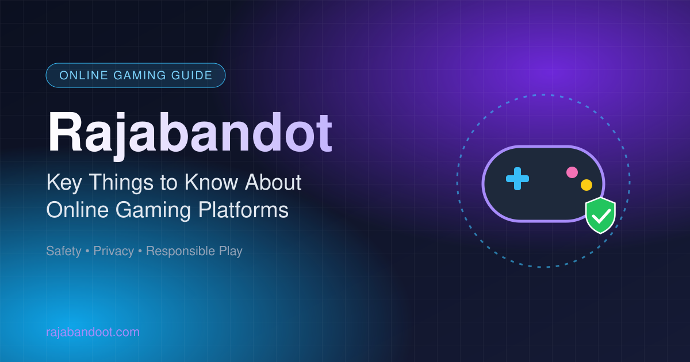

# Rajabandot: Key Things to Know About Online Gaming Platforms

  

[Rajabandot](https://rajabandoot.com/) is a search topic associated with online gaming and digital entertainment. When exploring an unfamiliar platform, visitors should review its accessibility, privacy policy, terms, and reliability. This guide explains practical checks that can help readers evaluate online services and make informed decisions.

Understanding how online platforms work can help visitors evaluate the information they find and make more informed decisions. This guide explores important considerations for anyone researching Rajabandot and the broader online gaming environment.

## Getting Familiar with Rajabandot

People searching for Rajabandot may want to learn about the brand, explore website content, or understand features commonly associated with digital gaming platforms. Before interacting with a website, visitors should confirm its domain and review the information it provides.

Readers can visit [**Rajabandot**](https://rajabandoot.com/) to explore the available content on the website. It is always sensible to verify website details independently rather than relying entirely on advertisements or third-party recommendations.

A reliable information resource should communicate its purpose clearly, organize content logically, and avoid making claims that cannot be supported.

## What Should Users Look for in an Online Platform?

Choosing how to interact with an online service requires more than judging its visual appearance. Several practical factors deserve attention.

### Website Performance and Accessibility

A website should load efficiently and remain easy to navigate across different devices. Clear menus, readable fonts, and well-organized pages help visitors find information without unnecessary effort.

Mobile compatibility is particularly important because many people access online services through smartphones. Responsive layouts allow website elements to adjust to different screen sizes while maintaining readability.

### Clear Terms and Conditions

Before using a service, visitors should review its terms and conditions. These documents may explain eligibility, account requirements, restrictions, and other important details.

If a platform offers paid services, users should also check applicable fees and payment conditions before committing money. Unclear policies are a reason to pause and seek clarification.

### Reliable Information

Informational pages should distinguish verified facts from opinions and promotional statements. Readers can assess reliability by checking publication dates, looking for supporting sources, and comparing important details with independent references.

No website should be assumed trustworthy simply because it looks professional or uses convincing marketing language.

## Understanding Digital Security

Online security is an essential consideration when visiting unfamiliar websites. Users should check that they have entered the intended domain and remain cautious about unexpected links, downloads, and requests for personal information.

Using unique passwords and keeping devices updated can improve general account security. Visitors should never share passwords or one-time verification codes with strangers.

It is also useful to read a website's privacy policy to understand what information may be collected and how it may be used. If a website requests sensitive information without a clear reason, users should carefully reconsider proceeding.

## Responsible Gaming and Realistic Expectations

Some online gaming platforms include gambling-related activities. These activities can involve financial risks, so users should understand the applicable laws and eligibility requirements in their location before participating.

Lottery-style games and other games of chance do not offer guaranteed outcomes. Past results, number patterns, and predictions cannot ensure future winnings. Claims promising certain profits should therefore be treated with skepticism.

Where gambling is legal, responsible participation includes setting firm financial limits, avoiding borrowed money, and never using funds reserved for essential expenses. Gambling should not be considered a dependable way to earn income.

## How Quality Content Improves the Online Experience

Useful content helps visitors understand a topic without forcing them to search through multiple confusing pages. Clear explanations, relevant headings, and practical guidance can make a website more valuable to its audience.

For publishers working with the Rajabandot keyword, a thoughtful content strategy should focus on answering genuine questions. Original articles, accurate descriptions, natural keyword placement, and descriptive image text can support a more organized website.

Search engine optimization works best when it complements a useful experience for readers rather than replacing it with repetitive keywords or unsupported claims.

## Conclusion

Rajabandot is a relevant search topic for people exploring online gaming information, digital services, website accessibility, and internet safety. Learning how to evaluate online platforms can help visitors identify useful information and recognize potential risks.

Before using [Rajabandot](https://rajabandoot.com/), verify the website address, review its policies, protect personal information, and understand the risks associated with gambling-related activities. A careful, informed approach helps visitors assess online services without relying on promotional claims or promises of guaranteed results.
